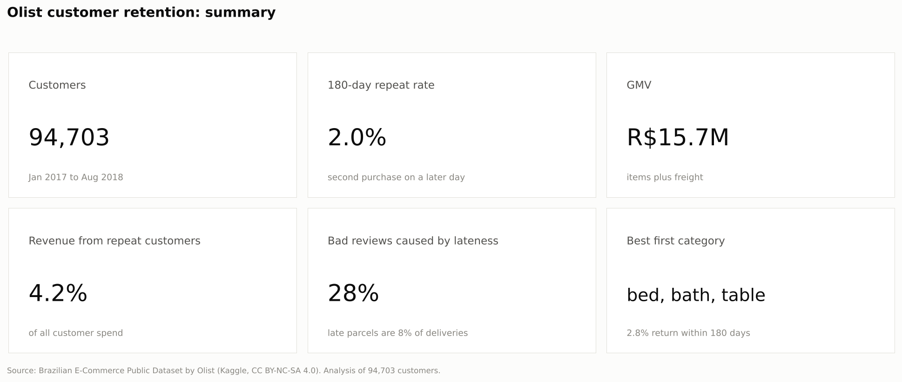
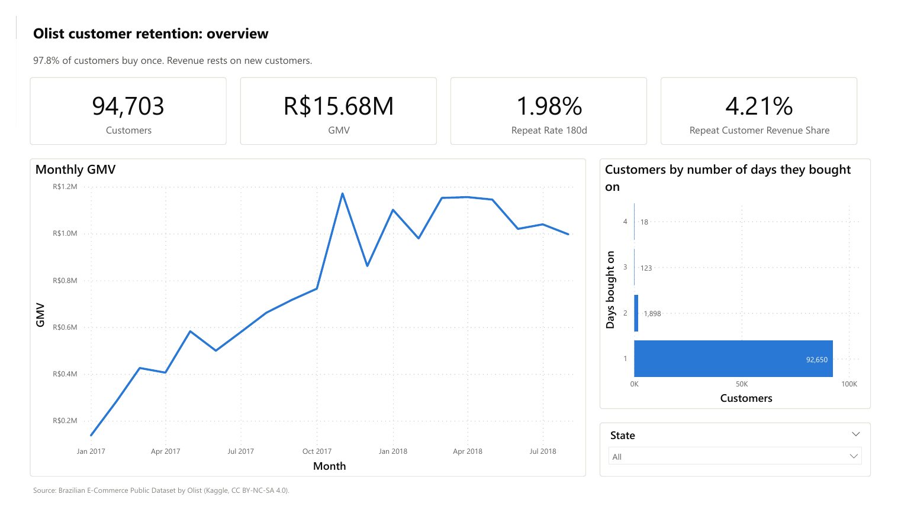
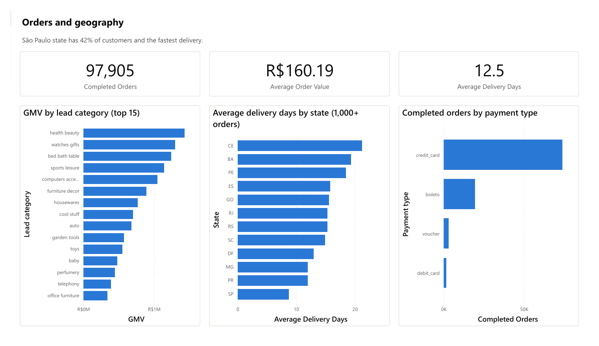
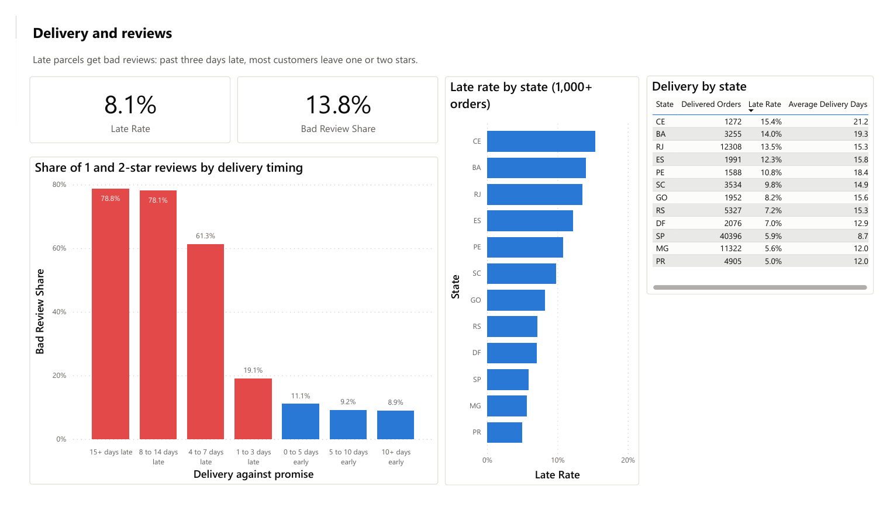
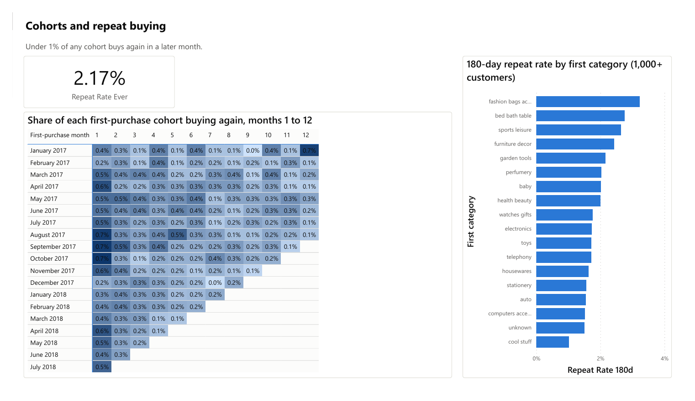
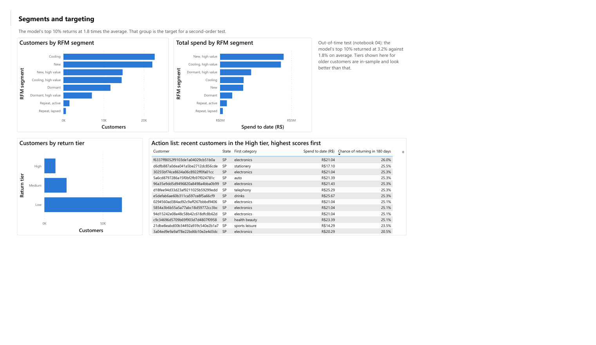

# Olist customer retention analysis

Why do 98% of customers on a Brazilian e-commerce platform never buy a second time, and what in their first order predicts whether they will? A retention study on 94,703 real customers and 97,905 orders.

## The business and the data

Olist is a Brazilian company that connects small shops to large online marketplaces. Shops list through Olist, customers buy on the marketplace, and Olist manages the order through to delivery.

The data is the "Brazilian E-Commerce Public Dataset by Olist", published by Olist on Kaggle: about 100,000 real, anonymised orders from September 2016 to October 2018, across nine linked tables (customers, orders, items, payments, reviews, products, sellers, category names and geolocation). Values are in Brazilian reais (R$).

Licence: CC BY-NC-SA 4.0. The data is free for non-commercial use with attribution to Olist, and anything derived from it is shared under the same licence. The raw files are not stored in this repository.

## Key findings

1. 97.8% of customers bought on a single day. Only 1.98% came back within 180 days, and about 2.2% ever did. Under 1% of any monthly cohort buys again in any later month.
2. About a third of apparent second orders are split carts placed the same day. Counting customers by `customer_id` hides repeat buying completely, because Olist issues a new `customer_id` for every order.
3. Late parcels wreck reviews. More than three days late, 60% to 76% of customers leave one or two stars. Late orders are 8% of deliveries but a third of all bad reviews.
4. Nothing in the first order moves the repeat rate much. The first order's category is the strongest signal: bed, bath and table, sports and furniture buyers return at up to 2.7 times the rate of gadget and car-part buyers. Review score and delivery speed show smaller real gaps, mostly explained by geography.
5. The first order says little about whether a customer will return. The best model (random forest, tested out of time on later customers) reaches a ROC AUC of 0.58. It is useful for one thing: its top 10% of scores returned at 1.8 times the average rate.
6. Customer value is almost entirely the first order. Raising the 180-day repeat rate from 2% to 3% would add about R$129,000 of GMV a year (1%), so retention spend has to be cheap: email, timing and category targeting, with any voucher tested against a hold-out group first.



## Follow-on project

The findings above say what to do. [Olist retention intervention analytics](https://github.com/JoshuaPaul-lasisi/retention-intervention-analytics) builds the layer that makes it operable: a dbt project on BigQuery that rebuilds these rules as tested models and produces the email targeting list by first category, the send window for each category, seller delivery performance by month, and the eligible population for a voucher test against a hold-out group. Its figures match this analysis exactly (94,703 customers, 1.98% 180-day repeat rate).

## Project structure

```
  notebooks/
    01_data_audit_and_preparation.ipynb   audit of the raw tables, builds the clean tables
    02_eda_rfm_segmentation.ipynb         revenue, geography, delivery and reviews; RFM segments
    03_cohort_retention_analysis.ipynb    cohort heatmap, time to second purchase, what predicts a return
    04_repeat_purchase_model.ipynb        predicts a second purchase within 180 days from the first order
    05_clv_and_recommendations.ipynb      customer value, size of the prize, playbook, one-page summary
  sql/
    00_views.sql                          clean order and customer tables built in SQL from the raw CSVs
    01_ to 06_*.sql                       headline KPIs, monthly GMV, cohorts, repeat by category,
                                          delivery and reviews, RFM segments
  scripts/
    run_sql.py                            runs the SQL with DuckDB and checks it against the notebooks
  src/
    olist.py                              shared paths, loading, chart style and helpers
  docs/
    power_bi_guide.md                     step-by-step build guide for the dashboard
    olist_theme.json                      Power BI theme matching the notebook charts
  dashboard/
    olist_retention.pbix                  Power BI report, five pages
    olist_retention.pdf                   the same report as a PDF
  data/
    raw/                                  Olist CSVs from Kaggle (not committed)
    processed/                            clean tables and notebook outputs (not committed, rebuilt by the notebooks)
  reports/figures/                        every chart the notebooks save
  models/                                 trained model
```

## How to run

1. Download the dataset from Kaggle: search "Brazilian E-Commerce Public Dataset by Olist" (olistbr/brazilian-ecommerce).
2. Unzip the CSV files into `data/raw/`.
3. Install and run:

```
pip install -r requirements.txt
cd notebooks
jupyter nbconvert --to notebook --execute --inplace 01_data_audit_and_preparation.ipynb
```

Run the notebooks in order, 01 first: it writes the clean tables the others read. You can also open them in Jupyter or VS Code and run all cells.

4. Run the SQL version (from the repository root):

```
python scripts/run_sql.py --check
```

The SQL rebuilds the clean tables from the raw CSVs on its own, using the same rules as notebook 01, then reproduces the headline KPIs, cohort matrix, repeat rates, delivery figures and RFM segments. With `--check` it compares each result with the notebook outputs. All ten checks match; the only gap is 46 customers whose first order had two items at the same top price, where SQL and pandas pick a different lead item.

5. Open `dashboard/olist_retention.pbix` in Power BI Desktop. It was built from the tables in `data/processed/`; to rebuild it from scratch, follow `docs/power_bi_guide.md`. If you open the file on a new machine, point its data source at your own `data/processed/` folder (Transform data, Data source settings).

## Dashboard

Five Power BI pages built on the notebook outputs. Every figure was checked against the notebooks and the SQL.

1. Overview: customers, GMV, repeat rate, monthly GMV, and how many days each customer bought on.



2. Orders and geography: revenue by category, delivery time by state, payment mix.



3. Delivery and reviews: bad-review share by how late the parcel arrived, late rate by state.



4. Cohorts and repeat buying: the cohort heatmap and 180-day repeat rate by first category.



5. Segments and targeting: RFM segments, the model's return tiers and the action list of recent High-tier customers.



## Limits of this analysis

1. The data stops in August 2018 and covers 20 usable months. The 180-day repeat rate can only be measured for customers who first bought before March 2018, and any longer-term value is out of reach.
2. Olist sells through marketplaces under each shop's name. The data can't show whether a customer bought again from the same shop on a channel Olist doesn't handle, so "never came back" means never came back through Olist.
3. There is no data on marketing, emails, site visits or customer demographics, the things most likely to explain who returns. The model only sees the first order, which is why it is weak.
4. Olist's commission and costs are not public, so value is measured as GMV (what customers paid). The voucher test in notebook 05 uses margin scenarios instead of a real margin.
5. Delivery problems are tied up with geography: slow parcels mostly go to distant states. The notebooks show the association but can't prove that faster delivery alone would change how often customers return.
6. No experiment was run. Every recommendation that involves an offer or a message should be tested against a hold-out group before rollout.

## Tools and libraries

Python (pandas, NumPy, scikit-learn, XGBoost, Matplotlib), Jupyter, SQL (DuckDB), Power BI.

## Build status

1. Notebook 01, data audit and preparation: done
2. Notebook 02, EDA and RFM segmentation: done
3. Notebook 03, cohort retention: done
4. Notebook 04, repeat-purchase model: done
5. Notebook 05, CLV and recommendations: done
6. SQL layer: done
7. Power BI dashboard: done

## Licence

The code in this repository is under the MIT licence (see `LICENSE`). The Olist data and anything derived from it, including the processed tables and the dashboard file, stay under CC BY-NC-SA 4.0 with attribution to Olist.

## Contact

GitHub: [JoshuaPaul-lasisi](https://github.com/JoshuaPaul-lasisi)
